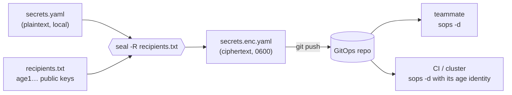

<div align="center">
  
  <h1>seald</h1>
  <p><strong>Seal a YAML secrets file to age public keys. Commit the ciphertext. Never leak the plaintext.</strong></p>
  <p>One small, auditable Bash command in front of <a href="https://github.com/getsops/sops">SOPS</a> and <a href="https://github.com/FiloSottile/age">age</a>, for GitOps repos that hold encrypted secrets.</p>

  <p>
    <a href="https://github.com/adammamaril/seald/actions/workflows/ci.yml"></a>
    
    <a href="https://github.com/getsops/sops"></a>
    <a href="LICENSE"></a>
  </p>
</div>

## Quickstart

Needs Bash and [sops](https://github.com/getsops/sops). Recipients are age public keys (`age1…`).

```sh
git clone https://github.com/adammamaril/seald && make -C seald install    # → ~/.local/bin/seal
seal -r age1alice… -r age1ci… secrets.yaml secrets.enc.yaml
git add secrets.enc.yaml                                                    # ciphertext only
```

Anyone holding one of those identities decrypts with `sops -d secrets.enc.yaml`.

## Usage

```
seal [-r AGE_PUBLIC_KEY]... [-R RECIPIENTS_FILE] [-f] INPUT.yaml OUTPUT.enc.yaml
```

| Option | Meaning |
|---|---|
| `-r age1…` | Add a recipient. Repeat for each person, machine or CI runner. |
| `-R FILE` | Read recipients from a file: one key per line, blank lines and `# comments` ignored. |
| `SEAL_RECIPIENTS=k1,k2` | Recipients from the environment (comma-separated). Combines with `-r` and `-R`. |
| `-f` | Replace an existing `OUTPUT`. Without it, `seal` refuses. |

A team recipients file keeps everyone in one place:

```sh
cat recipients.txt
# alice
age1aknmht27hk2h5r0eem4u667k3l7z22nqysyrq7lwaznvy2ahgghq7rs9hw
# ci runner
age17nf7hcxye2ejzhk93uu0z6rfh4mac3rpp28fyk748ndzgqhq8veslw8jdl

seal -R recipients.txt secrets.yaml secrets.enc.yaml
```

## How it works

**Inside one run.** Every check happens before SOPS is called, and the output only appears once encryption has succeeded:

```
 INPUT.yaml (plaintext, yours)
      │
      ▼
┌────────────────────────────────────────────────────────────────────────┐
│ seal                                          umask 077, no xtrace     │
│                                                                        │
│ 1. recipients   -r / -R / SEAL_RECIPIENTS ──▶ each must be age1…       │
│ 2. guards       input readable · output absent (or -f) · sops found    │
│ 3. encrypt      sops --encrypt --age k1,k2… INPUT ──▶ OUT.XXXXXX       │
│                 (ciphertext only, 0600, removed on any exit)           │
│ 4. publish      chmod 0600 · mv OUT.XXXXXX ──▶ OUTPUT.enc.yaml         │
│                                                                        │
└────────────────────────────────────┬───────────────────────────────────┘
                                     │  stdout: the output path, nothing else
                                     ▼
                       OUTPUT.enc.yaml (ciphertext, 0600)
```

**Across the team.** Plaintext stays on the author's machine. Git, reviewers and CI only ever see ciphertext:



## What it guarantees

| Guarantee | How |
|---|---|
| Plaintext is never copied | SOPS reads `INPUT` directly. `seal` writes no plaintext temp file, buffer or log. |
| Output is private from the start | `umask 077` before anything is created, then an explicit `chmod 0600`. |
| No half-written or clobbered files | Ciphertext goes to a temp file beside the output and is moved into place only on success. An existing output is kept unless you pass `-f`, and kept even then if encryption fails. |
| Nothing left behind | The temp file is removed on every exit, success or failure. |
| Secrets never reach your terminal | stdout carries only the output path, stderr only a status line. `seal` refuses to run under `bash -x`. |
| Bad keys fail loudly | Each recipient must look like an age public key, and at least one is required. |

Every row is covered by the test suite in [`tests/`](tests).

## Keep in mind

- **`seal` does not delete your plaintext `INPUT.yaml`.** Keep it out of git (`.gitignore` it) and remove it when you're done. On copy-on-write or SSD storage, deleting is not a secure erase; prefer keeping plaintext on an encrypted disk or a tmpfs.
- Recipient checks are a shape check (`age1…`). SOPS and age do the real validation, and a wrong but well-formed key will still encrypt to the wrong person. Check your recipients file in review.
- Anyone with a matching age identity can decrypt. Removing a recipient only affects files you re-seal afterwards; rotate the secrets themselves if a key is lost.
- You have to trust the machine you run it on. `seal` cannot protect plaintext on a compromised host.

## Development

```sh
make test                      # needs age-keygen and sops; tests skip without them
shellcheck bin/seal
make install PREFIX=/usr/local # or uninstall
```

## License

MIT © 2026 Genga Labs. See [LICENSE](LICENSE).

<details>
<summary>Logo artwork</summary>
<br>

</details>

<p align="center"><sub>Built and maintained by <strong>Genga Labs</strong>.</sub></p>
