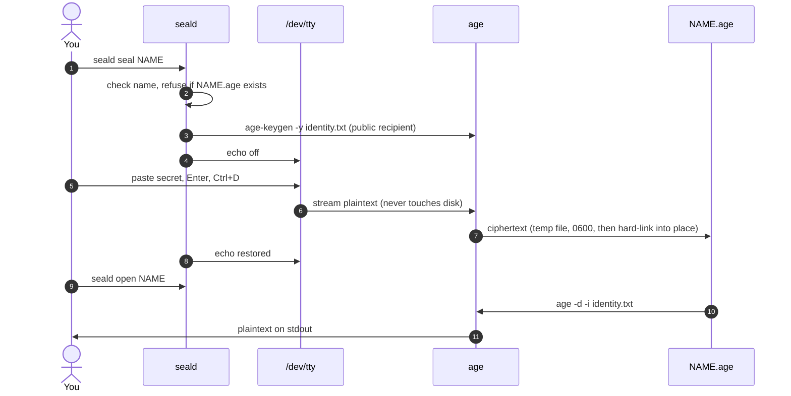

<div align="center">
  
  <h1>seald</h1>
  <p><strong>Paste a secret. Seal it with age. Carry on.</strong></p>
  <p>A tiny local CLI that takes a hidden paste straight from your terminal into an <a href="https://github.com/FiloSottile/age">age</a>-encrypted file. No plaintext file is written, and existing secrets are never overwritten.</p>

  <p>
    <a href="https://github.com/adammamaril/seald/actions/workflows/ci.yml"></a>
    
    <a href="https://github.com/FiloSottile/age"></a>
    <a href="LICENSE"></a>
  </p>
</div>

## Quickstart

Requires Python 3 and [age](https://github.com/FiloSottile/age) (including `age-keygen`) on a Unix-like system.

```sh
pipx install git+https://github.com/adammamaril/seald   # or: pip install git+https://github.com/adammamaril/seald
seald init
seald seal cloudflare-token
```

Paste the value, press **Enter**, then press **Ctrl+D on an empty line**. Input is hidden, and multiline values work.

```sh
seald list
seald open cloudflare-token   # writes plaintext to stdout
```

The install puts two commands on your PATH: `seald` (this quickstart) and `seal` (SOPS file sealing, see [Two tools](#two-tools)).

No install? Clone the repo and run `./seald` or `./bin/seal` in place.

## Two tools

The package installs two commands. They do different jobs, so don't mix up `seal` with the `seald seal` subcommand.

| Tool | For | Input | Output | Needs |
|---|---|---|---|---|
| `seald` | Stashing one secret fast, for yourself | Hidden terminal paste | `NAME.age` in your local store | `age`, `age-keygen` |
| `seal` | Sharing a secrets file with one or more people or machines | Plaintext `INPUT.yaml` | SOPS-encrypted `OUTPUT.enc.yaml` (0600) | `sops` |

### `seal`: SOPS YAML to age recipients

```sh
seal -r age1alice... -r age1ci... secrets.yaml secrets.enc.yaml
seal -R recipients.txt secrets.yaml secrets.enc.yaml        # one age1... key per line, # comments ok
SEAL_RECIPIENTS=age1alice...,age1ci... seal secrets.yaml secrets.enc.yaml
sops -d secrets.enc.yaml                                     # decrypt (needs a matching age identity)
```

The output is created with mode 0600. An existing output is never replaced unless you pass `-f`, and the file is only swapped in once encryption succeeds. `seal` prints the output path, never a secret.

## How it works

**What's on disk.** One directory, one key, one file per secret:

```
~/.local/share/seald/          (or $SEALD_HOME, mode 0700)
├── identity.txt               age private key · 0600 · created by init, never replaced
├── cloudflare-token.age       ciphertext · 0600 · refuses to overwrite
└── github-pat.age             ciphertext · 0600
```

**What happens when you seal and open.** Plaintext only exists in the pipe to age and on stdout:



- `init` generates an age identity in `identity.txt`. Each secret is encrypted to its own `NAME.age` file.
- Names may contain letters, numbers, dots, underscores and dashes, and must start with a letter or number.
- `seald seal` requires a real terminal and stops if it cannot turn off echo. Plaintext is streamed to age and never saved to a plaintext file.
- `seald seal` refuses to overwrite a name. To replace a secret, remove its encrypted file on purpose and seal it again.

## Keep in mind

- **Back up `identity.txt` securely.** If you lose it, you lose access to your sealed secrets.
- The private key and the encrypted files sit in the same store, protected only by filesystem permissions. Anyone who can read both can decrypt the secrets. This is **not isolation from your own user account or from agents running as you**.
- `open` prints plaintext to standard output. Watch out for terminal scrollback, logs, screen sharing and shell redirection. Don't pass secrets as command arguments.
- You have to trust the terminal, its host, and any process that can inspect them. seald cannot protect secrets on a compromised machine.
- `seal` leaves your plaintext `INPUT.yaml` on disk. Deleting it is up to you.

## Development

With age installed, run:

```sh
python3 -m unittest discover -s tests -v
```

The tests use a temporary home and synthetic values.

seald was inspired by a local `seal-paste.sh` workflow (a tiny hidden paste straight into age). This repository is a fresh implementation.

<details>
<summary>Logo artwork</summary>
<br>

</details>

## License

MIT © 2026 Genga Labs. See [LICENSE](LICENSE).

<p align="center"><sub>Built and maintained by <strong>Genga Labs</strong>.</sub></p>
