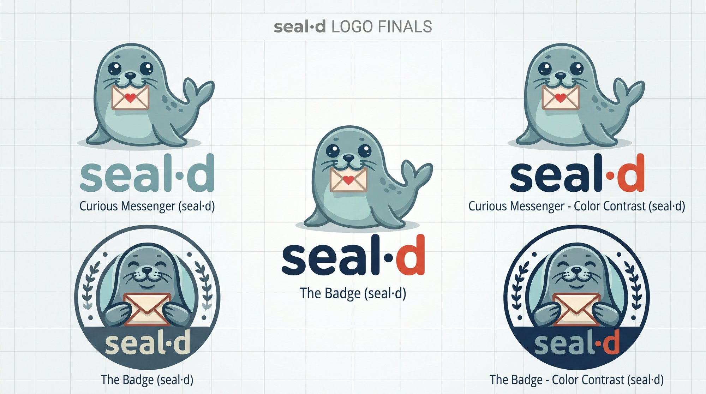

<div align="center">
  
  <h1>seald</h1>
  <p><strong>One command for every credential, for operators and agents.</strong></p>
  <p>Type a secret once at a hidden prompt. It goes into a single encrypted <a href="https://github.com/getsops/sops">SOPS</a> + <a href="https://github.com/FiloSottile/age">age</a> ledger, and your daemons, scripts and agents get it as environment variables. A small Bash script with no daemon.</p>

  <p>
    <a href="https://github.com/adammamaril/seald/actions/workflows/ci.yml"></a>
    
    <a href="https://github.com/getsops/sops"></a>
    <a href="LICENSE"></a>
  </p>
</div>

## Quickstart

```sh
git clone https://github.com/adammamaril/seald && cd seald
./seal set GITHUB_TOKEN          # hidden prompt, asked twice
./seal exec -- gh repo list      # gh sees $GITHUB_TOKEN; your shell never does
```

`seal` is one self-contained Bash script: run it from the clone, or copy it anywhere. Needs Bash, [sops](https://github.com/getsops/sops) and [jq](https://jqlang.github.io/jq/). Need them? Run `./scripts/install-deps.sh` (or `make deps`). It uses brew, apt, pacman or dnf, and fetches a checksum-verified sops release if your distro doesn't package it. `seal` also needs an age identity, so if you don't have one yet, run this once (it uses `age-keygen`):

```sh
mkdir -p ~/.config/sops/age
age-keygen -o ~/.config/sops/age/keys.txt                                   # private: sops decrypts with this
age-keygen -y ~/.config/sops/age/keys.txt > ~/.config/sops/age/pubs.txt     # public: seal encrypts to this
```

## Usage

```
seal [-l LEDGER] set KEY [--stdin]        store a secret; a second set rotates it
seal [-l LEDGER] get KEY                  print the secret to stdout
seal [-l LEDGER] list                     list key names, never values
seal [-l LEDGER] rm KEY                   delete a key
seal [-l LEDGER] exec -- CMD [ARG]...     run CMD with every key as an environment variable
seal file [-r KEY]... [-R FILE] [-f] INPUT.yaml OUTPUT.enc.yaml
                                          encrypt a whole YAML file (the ledger is not used)
```

- **Key names** must match `[A-Za-z_][A-Za-z0-9_]*`, because each one becomes an environment variable.
- **Ledger:** `-l FILE`, or `SEAL_LEDGER`. The default is `~/.local/share/seal/secrets.enc.yaml`, mode 0600, and the first `set` creates it.
- **Recipients** (age public keys, `age1…`) come from `SEAL_RECIPIENTS` (comma-separated). If that's unset, they come from `SEAL_RECIPIENTS_FILE` (default `~/.config/sops/age/pubs.txt`).
- **Decryption** uses sops' usual identity: `SOPS_AGE_KEY_FILE`, or `~/.config/sops/age/keys.txt`.

Scripts can pipe a value in instead of typing it. When stdin isn't a terminal, or `--stdin` is given, the whole of stdin is stored:

```sh
printf %s "$VALUE" | seal set API_KEY
```

### Batch lane: `seal file`

To share a whole YAML secrets file with a team or a cluster, encrypt it to several recipients and commit the ciphertext:

```sh
seal file -R recipients.txt secrets.yaml secrets.enc.yaml    # -r age1… per key, -f to replace
sops -d secrets.enc.yaml                                     # anyone holding a matching identity
```

Recipients come from `-r` (repeatable), from `-R FILE` (one per line, with blank lines and `# comments` ignored) and from `SEAL_RECIPIENTS`. If none are given, `seal file` falls back to the same default recipients file as the ledger. An existing output is kept unless you pass `-f`. On stdout it prints only the output path.

## For agents: use `seal exec`, not `seal get`

> [!IMPORTANT]
> `seal get` prints the plaintext to stdout. For an agent, stdout means the value lands in its context, its transcript and any logs. Hand agents `seal exec -- CMD` instead. The command receives the secrets as environment variables, and the agent sees only the command's own output.

```sh
seal exec -- my-daemon --serve        # daemons, agents and scripts read $KEY from the environment
seal list                             # safe to show an agent: names only
```

## How it works

**Storing a secret.** The value goes from a hidden prompt through a pipe into `sops set`. It never appears in a command line, a plaintext file, or on screen:

```
 seal set GITHUB_TOKEN   (you type the value; plaintext)
      │
      ▼
┌──────────────────────────────────────────────────────────────────────────┐
│ seal set                                     umask 077 · refuses bash -x │
│                                                                          │
│ 1. key name      [A-Za-z_][A-Za-z0-9_]*  (becomes an env var name)       │
│ 2. hidden prompt read -s, asked twice, must match and not be empty       │
│                  (or piped / --stdin: the whole of stdin)                │
│ 3. first set     recipients: SEAL_RECIPIENTS or ~/.config/sops/age/pubs  │
│                  creates an empty ledger: temp file, 0600, mv into place │
│ 4. store         printf %s | jq -Rs . | sops set --value-stdin LEDGER    │
│                  then chmod 0600                                         │
│                                                                          │
│ the value is never in argv, never on disk in clear, never echoed         │
└─────────────────────────────────────┬────────────────────────────────────┘
                                      ▼
            ~/.local/share/seal/secrets.enc.yaml (ciphertext, 0600)
```

**Using your secrets.** One ledger, three ways out:

```
                       ┌──▶ seal exec -- CMD   CMD gets every key as an env var   ◀ agents: use this
 secrets.enc.yaml  ────┼──▶ seal get KEY       the value, in plaintext, on stdout
 (ciphertext, 0600)    └──▶ seal list          key names only
```

`seal file IN.yaml OUT.enc.yaml` is a separate batch lane: it encrypts a whole YAML file and never touches the ledger.

## What it guarantees

| Guarantee | How |
|---|---|
| Secrets stay out of argv | The value moves through shell builtins and pipes into `sops set --value-stdin`, never as a command argument. |
| No plaintext on disk | `seal` writes no plaintext file. The ledger and `seal file` output are ciphertext. |
| Hidden input | The prompt reads with echo off, asks twice, and rejects empty or mismatched entries. |
| Private files | `umask 077`, then an explicit `chmod 0600` on the ledger and outputs. New files are written to a temp file and moved into place. |
| Only `get` prints a secret | `set` and `rm` print a status line, `list` prints names, `file` prints the output path. |
| Safe under debugging | `seal` refuses to run under `bash -x`. |

The test suite in [`tests/`](tests) exercises these behaviours.

## Keep in mind

- **Agents: prefer `seal exec`.** `seal get` puts plaintext on stdout, and from there into agent context, transcripts and logs.
- **`echo` adds a newline, and seal stores it.** Piped input is stored exactly as received. Use `printf %s "$VALUE" | seal set KEY`, or type at the prompt. The prompt reads a single line, so use stdin for multi-line values.
- **`exec` puts secrets in the environment.** The command and its children can read them, and so can anything able to inspect that process as your user.
- **Recipients are fixed when the ledger is created.** Changing `SEAL_RECIPIENTS` or `pubs.txt` later doesn't re-encrypt an existing ledger.
- **`rm` and rotation don't reach copies.** Old values stay in any backups or git history of the ledger, so rotate the secret itself if it may have leaked.
- **`seal file` does not delete your plaintext `INPUT.yaml`.** Keep it out of git and remove it when you're done. Its recipient check is a shape check (`age1…`), so a wrong but well-formed key still encrypts to the wrong person.
- Anyone with a matching age identity can decrypt. Back up `keys.txt`: lose it and you lose the ledger.
- You have to trust the machine you run it on. `seal` cannot protect secrets on a compromised host.

## Development

```sh
make test                      # needs age-keygen, sops and jq; tests skip without them
shellcheck seal scripts/install-deps.sh
```

Optional: put `seal` on your PATH instead of running `./seal`:

```sh
make install                   # → ~/.local/bin/seal   (PREFIX=/usr/local to change, make uninstall to undo)
```

## License

MIT © 2026 Genga Labs. See [LICENSE](LICENSE).

<details>
<summary>Logo artwork</summary>
<br>

</details>

<p align="center"><sub>Built and maintained by <strong>Genga Labs</strong>.</sub></p>
