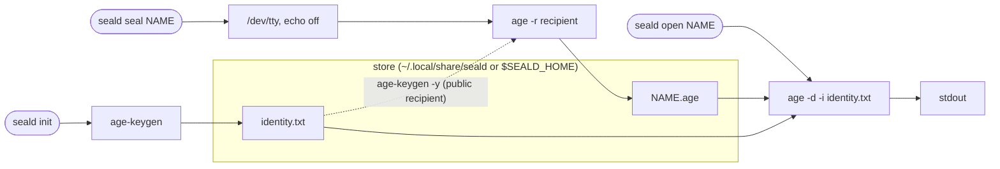

<div align="center">
  
  <h1>seald</h1>
  <p><strong>Paste a secret. Seal it with age. Carry on.</strong></p>
  <p>A tiny local CLI that takes a hidden paste straight from your terminal into an <a href="https://github.com/FiloSottile/age">age</a>-encrypted file. No plaintext file is written, and existing secrets are never overwritten.</p>

  <p>
    <a href="https://github.com/adammamaril/seald/actions/workflows/ci.yml"></a>
    
    <a href="https://github.com/FiloSottile/age"></a>
    <a href="LICENSE"></a>
  </p>
</div>

## Quickstart

Requires Python 3 and [age](https://github.com/FiloSottile/age) (including `age-keygen`) on a Unix-like system.

```sh
pipx install git+https://github.com/adammamaril/seald   # or: pip install git+https://github.com/adammamaril/seald
seald init
seald seal cloudflare-token
```

Paste the value, press **Enter**, then press **Ctrl+D on an empty line**. Input is hidden, and multiline values work.

```sh
seald list
seald open cloudflare-token   # writes plaintext to stdout
```

No install? Clone the repo and run `./seald` in place. It's a clone-and-run shim for the same tool.

## How it works

```
                 ┌─ store: ~/.local/share/seald (or $SEALD_HOME) ─────────────────────┐
 seald init ───▶ │  age-keygen ──────────▶ identity.txt  (0600, created once, never   │
                 │                                        replaced)                   │
                 │                                                                    │
 seald seal NAME │  /dev/tty (echo off) ──▶ age -r <recipient> ──▶ NAME.age           │
                 │     hidden paste          streamed, no plaintext  refuses to       │
                 │                           file                    overwrite        │
                 │                                                                    │
 seald open NAME │  NAME.age ──▶ age -d -i identity.txt ──▶ stdout (plaintext)        │
                 └────────────────────────────────────────────────────────────────────┘
```



- `init` generates an age identity in `identity.txt`. Each secret is encrypted to its own `NAME.age` file.
- Names may contain letters, numbers, dots, underscores and dashes, and must start with a letter or number.
- `seal` requires a real terminal and stops if it cannot turn off echo. Plaintext is streamed to age and never saved to a plaintext file.
- `seal` refuses to overwrite a name. To replace a secret, remove its encrypted file on purpose and seal it again.

## Keep in mind

- **Back up `identity.txt` securely.** If you lose it, you lose access to your sealed secrets.
- The private key and the encrypted files sit in the same store, protected only by filesystem permissions. Anyone who can read both can decrypt the secrets. This is **not isolation from your own user account or from agents running as you**.
- `open` prints plaintext to standard output. Watch out for terminal scrollback, logs, screen sharing and shell redirection. Don't pass secrets as command arguments.
- You have to trust the terminal, its host, and any process that can inspect them. seald cannot protect secrets on a compromised machine.

## Development

With age installed, run:

```sh
python3 -m unittest discover -s tests -v
```

The tests use a temporary home and synthetic values.

seald was inspired by a local `seal-paste.sh` workflow (a tiny hidden paste straight into age). This repository is a fresh implementation.

<details>
<summary>Logo artwork</summary>
<br>

</details>

## License

MIT. See [LICENSE](LICENSE).
